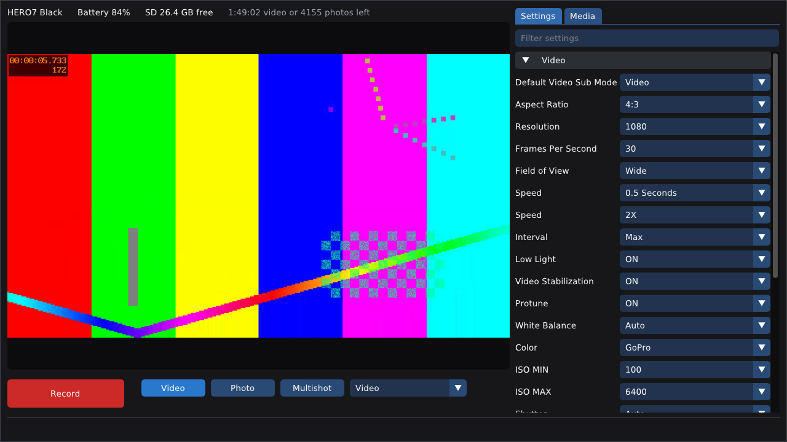

# gopro-cli

Control a **GoPro HERO7 Black** from a computer over Wi-Fi: live preview,
recording, photos, modes, every camera setting, and the files on the SD card.
Runs on Linux, macOS and Windows. Written in C++17.

[Українською](README.uk.md)



*`gopro-gui` connected to the camera emulator from `tools/`, which is why the
preview shows a test pattern.*

GoPro's official Open GoPro API starts with the HERO9. Older cameras such as
the HERO7 speak an undocumented HTTP protocol that the community reverse
engineered; this project is a desktop client for it.

## What is in the box

| Program | What it is |
|---|---|
| `gopro-gui` | Window with live preview, shutter, modes, all settings, media browser |
| `gopro` | The same from the command line, scriptable |
| `libgopro` | Static library both are built on (`src/camera.*`) |

Settings are not hard-coded. The camera publishes a schema of its own modes,
settings and options, and both programs are generated from it at run time, so
they show exactly what your firmware supports.

## Status

| | Linux | macOS | Windows |
|---|---|---|---|
| Builds and passes the emulator test | yes | checked by CI | checked by CI |
| Tested with a real HERO7 Black | yes (Debian 13, firmware HD7.01.01.90.00) | not yet | not yet |

The macOS and Windows builds are verified by GitHub Actions
(`.github/workflows/build.yml`), not yet on real machines with a camera.

Other cameras of the same generation (HERO5, HERO6, HERO 2018) use the same
protocol and may work; none has been tested.

## Build

### Linux (Debian / Ubuntu)

```bash
sudo apt install build-essential cmake libcurl4-openssl-dev nlohmann-json3-dev \
    libsdl2-dev libgl-dev libavformat-dev libavcodec-dev libavutil-dev libswscale-dev
cmake -S . -B build
cmake --build build -j
sudo cmake --install build        # optional: installs gopro and gopro-gui
```

### macOS

```bash
brew install cmake nlohmann-json sdl2 ffmpeg pkgconf
cmake -S . -B build
cmake --build build -j
```

### Windows (Visual Studio 2022 + vcpkg)

```powershell
git clone https://github.com/microsoft/vcpkg C:\vcpkg
C:\vcpkg\bootstrap-vcpkg.bat
cmake -S . -B build -DCMAKE_TOOLCHAIN_FILE=C:\vcpkg\scripts\buildsystems\vcpkg.cmake
cmake --build build --config Release
```

vcpkg reads `vcpkg.json` and builds the dependencies on the first configure;
FFmpeg makes that first run slow. The programs end up in `build\Release`.

Command line only, without SDL2 and FFmpeg: add `-DGOPRO_BUILD_GUI=OFF`.

## Connect

1. On the camera: swipe down, *Preferences > Connections*. Turn wireless
   connections on. *Camera Info* shows the network name and password.
   If the password is unknown (second-hand camera): *Reset Connections*.
2. Join that Wi-Fi network from the computer.
3. Run `gopro-gui`, or `gopro status`.

While the computer is on the camera's network it has no internet over Wi-Fi.
A wired connection keeps working.

## gopro-gui

- Left: live preview, the shutter button (Record / Stop / Take photo), modes
  and sub-modes, HiLight tag while recording.
- *Settings*: every setting the camera reports, with a filter box. If the
  camera refuses a combination, the footer says so.
- *Media*: files on the card. *Save* downloads to `~/GoPro`, *Delete* asks first.
- The app waits for the camera and reconnects by itself.
- On a high-DPI screen: `gopro-gui --scale 1.5`.

## gopro (command line)

```
gopro status                      battery, mode, SD card
gopro record start | stop
gopro photo
gopro mode                        list modes and sub-modes
gopro mode video timewarp
gopro settings video              settings and current values
gopro get video.fps               options of one setting
gopro set video.resolution 1080
gopro media ls
gopro media get last -o ~/Videos
gopro media get all  -o ~/Videos  skips files already downloaded
gopro media rm GH010001.MP4       asks before deleting
gopro preview                     live picture through ffplay
gopro time                        set the camera clock
gopro -v status                   show every request and the camera's answer
gopro --help
```

## Test without a camera

`tools/mock_camera.py` imitates the camera's HTTP API using a schema captured
from a real HERO7 Black.

```bash
ctest --test-dir build --output-on-failure     # runs tests/smoke_test.py

python3 tools/mock_camera.py &                 # or try things by hand
export GOPRO_HOST=127.0.0.1 GOPRO_PORT=8099 GOPRO_MEDIA_PORT=8099
./build/gopro status
```

## Layout

```
src/platform.*      the only OS-specific code (sockets, folders, time)
src/http.*          HTTP GET and downloads (libcurl)
src/camera.*        class Camera: schema, state, commands, media, preview
src/main.cpp        gopro (command line)
src/gui/            gopro-gui: main_gui.cpp (Dear ImGui), worker.* (camera
                    thread), video_stream.* (FFmpeg decoding thread)
tools/              camera emulator and the HERO7 Black schema
tests/              end-to-end test of the CLI against the emulator
docs/PROTOCOL.md    what was confirmed on the real camera
third_party/imgui   Dear ImGui (MIT)
```

## Known limits

- Wi-Fi only. This camera generation has no control over USB; by cable it is
  a file-transfer (MTP) device.
- The preview has a noticeable delay, most of it inside the camera.
- `gopro wake` (Wake-on-LAN) is untested.
- Options the camera would refuse in the current mode are still listed; the
  app reports the refusal instead of hiding them.

## Credits and licence

MIT, see [LICENSE](LICENSE). Third-party material is listed in
[THIRD_PARTY.md](THIRD_PARTY.md). The protocol was documented by the
[goprowifihack](https://github.com/KonradIT/goprowifihack) community.

This project is not affiliated with or endorsed by GoPro, Inc. GoPro and HERO
are trademarks of GoPro, Inc.
