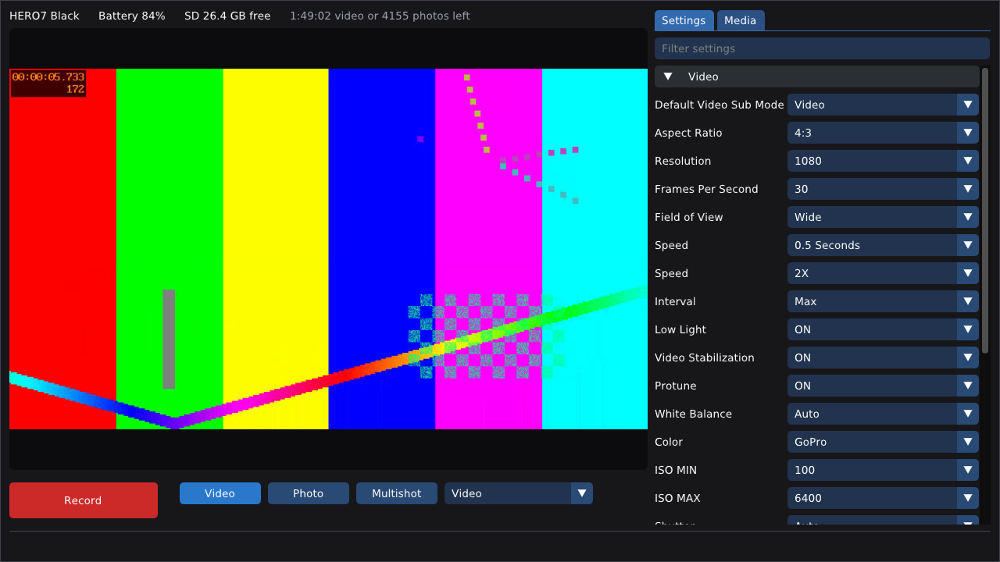

# gopro-cli

Керування **GoPro HERO7 Black** з комп'ютера через Wi-Fi: живе зображення,
запис, фото, режими, усі налаштування камери та файли на SD-карті.
Працює на Linux, macOS і Windows. Написано на C++17.

[English](README.md)



*`gopro-gui`, підключений до емулятора камери з `tools/`, тому замість
зображення тестова картинка.*

Офіційний Open GoPro API починається з HERO9. Старші камери, зокрема HERO7,
використовують недокументований HTTP-протокол, який розібрала спільнота.
Цей проєкт є настільним клієнтом для нього.

## Що всередині

| Програма | Що це |
|---|---|
| `gopro-gui` | Вікно з живим зображенням, кнопкою зйомки, режимами, налаштуваннями та файлами |
| `gopro` | Те саме з командного рядка, зручно для скриптів |
| `libgopro` | Статична бібліотека, на якій побудовано обидві (`src/camera.*`) |

Налаштування не зашиті в код. Камера сама віддає опис своїх режимів і
варіантів, і обидві програми будуються з нього під час роботи.

## Стан

| | Linux | macOS | Windows |
|---|---|---|---|
| Збирається і проходить тест на емуляторі | так | перевіряє CI | перевіряє CI |
| Перевірено на справжній HERO7 Black | так (Debian 13, прошивка HD7.01.01.90.00) | ще ні | ще ні |

## Збірка

### Linux (Debian / Ubuntu)

```bash
sudo apt install build-essential cmake libcurl4-openssl-dev nlohmann-json3-dev \
    libsdl2-dev libgl-dev libavformat-dev libavcodec-dev libavutil-dev libswscale-dev
cmake -S . -B build
cmake --build build -j
sudo cmake --install build        # необов'язково
```

### macOS

```bash
brew install cmake nlohmann-json sdl2 ffmpeg pkgconf
cmake -S . -B build
cmake --build build -j
```

### Windows (Visual Studio 2022 + vcpkg)

```powershell
git clone https://github.com/microsoft/vcpkg C:\vcpkg
C:\vcpkg\bootstrap-vcpkg.bat
cmake -S . -B build -DCMAKE_TOOLCHAIN_FILE=C:\vcpkg\scripts\buildsystems\vcpkg.cmake
cmake --build build --config Release
```

vcpkg читає `vcpkg.json` і сам збирає залежності під час першої конфігурації
(через FFmpeg це довго). Програми з'являться в `build\Release`.

Лише командний рядок, без SDL2 і FFmpeg: додай `-DGOPRO_BUILD_GUI=OFF`.

Після перенесення теки проєкту видали `build` і повтори `cmake -S . -B build`.

## Підключення

1. На камері: свайп униз, *Preferences > Connections*. Увімкни бездротове
   з'єднання. У *Camera Info* є назва мережі та пароль. Якщо пароль невідомий
   (камера з рук): *Reset Connections*.
2. Підключи комп'ютер до цієї мережі Wi-Fi.
3. Запусти `gopro-gui` або `gopro status`.

Поки комп'ютер у мережі камери, інтернету через Wi-Fi немає. Кабельне
з'єднання працює далі.

## gopro-gui

- Ліворуч: живе зображення, кнопка зйомки, режими та підрежими, HiLight-мітка.
- *Settings*: усі налаштування камери з пошуком. Якщо камера відхиляє
  комбінацію, про це пише рядок унизу.
- *Media*: файли на карті. *Save* зберігає в `~/GoPro`, *Delete* питає підтвердження.
- Програма чекає на камеру і підключається сама.
- На екрані з високою щільністю: `gopro-gui --scale 1.5`.

## gopro (командний рядок)

```
gopro status                      батарея, режим, карта
gopro record start | stop
gopro photo
gopro mode                        список режимів і підрежимів
gopro mode video timewarp
gopro settings video              налаштування і поточні значення
gopro get video.fps               варіанти одного налаштування
gopro set video.resolution 1080
gopro media ls
gopro media get last -o ~/Videos
gopro media get all  -o ~/Videos  вже завантажені пропускає
gopro media rm GH010001.MP4       питає підтвердження
gopro preview                     живе зображення через ffplay
gopro time                        виставити годинник камери
gopro -v status                   показати всі запити до камери
gopro --help
```

## Тест без камери

```bash
ctest --test-dir build --output-on-failure

python3 tools/mock_camera.py &
export GOPRO_HOST=127.0.0.1 GOPRO_PORT=8099 GOPRO_MEDIA_PORT=8099
./build/gopro status
```

## Обмеження

- Лише Wi-Fi. Керування по USB у цього покоління камер немає; по кабелю це
  пристрій передачі файлів (MTP).
- Живе зображення має помітну затримку, більша її частина виникає в камері.
- `gopro wake` (Wake-on-LAN) не перевірено.

Структура коду, нотатки про протокол і ліцензії: див. [README.md](README.md),
[docs/PROTOCOL.md](docs/PROTOCOL.md), [THIRD_PARTY.md](THIRD_PARTY.md).

Ліцензія MIT. Проєкт не пов'язаний з GoPro, Inc.
